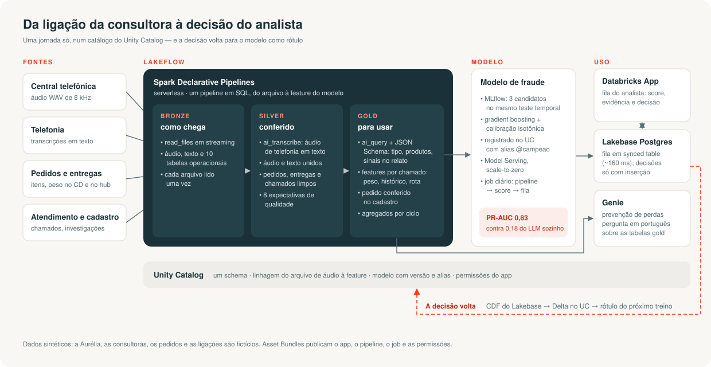
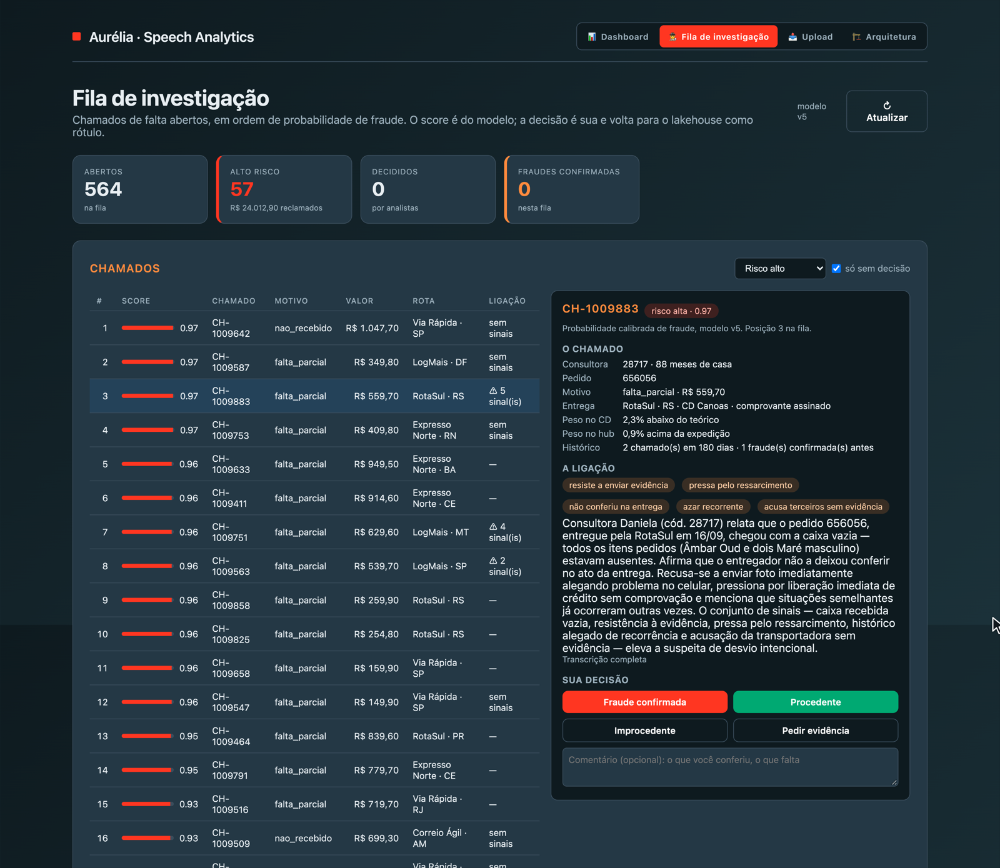
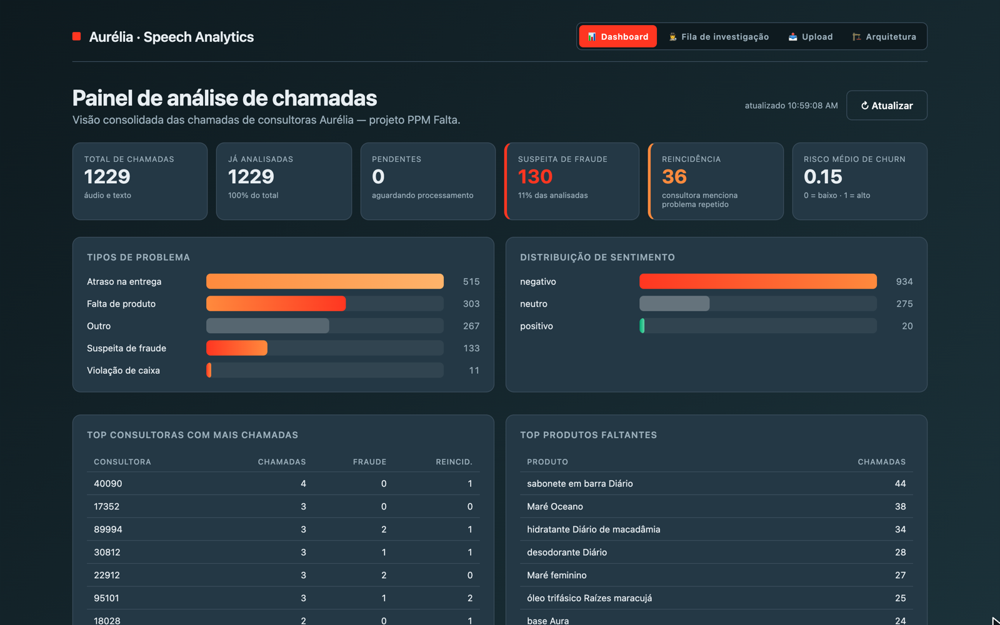

# Aurélia · Chamados de falta e fraude

A Aurélia Cosméticos (fictícia) vende por um milhão de consultoras. Quando um
pedido chega com produto faltando, a consultora liga para a central, e a Aurélia
ressarce. Parte desses chamados é fraude: a consultora recebeu e diz que não. Hoje
um analista ouve uma amostra das ligações, a investigação é escolhida por valor e
reincidência, e encontra metade do valor em fraude.

Este build troca a amostra por todas as ligações e a regra por uma fila: transcreve
e estrutura cada ligação, junta com pedido, entrega e histórico, pontua cada chamado
com um modelo calibrado e entrega ao analista uma fila em ordem de probabilidade de
fraude. A decisão do analista volta para o lakehouse como rótulo.

Tudo roda em dados sintéticos: a empresa, as consultoras, os pedidos, as ligações e
os números são fictícios.

https://github.com/user-attachments/assets/ce6e2df3-66d2-4979-9dec-02f391aeabbf

Um minuto de app: as ligações analisadas, a fila em ordem de probabilidade de fraude,
o caso com peso da caixa, histórico e sinais da ligação, e a decisão do analista
gravada no Lakebase. O mesmo vídeo está em
[`docs/media/demo-fila-investigacao.mp4`](docs/media/demo-fila-investigacao.mp4).

## Resultado

| Medida | Resultado |
|---|---|
| Transcrição (30 ligações de telefonia com gabarito) | 5,2% de erro de palavras; tipo do problema, suspeita de desvio e produtos 100% |
| Número do pedido extraído da ligação | 80% (áudio) e 86,6% (texto); **100% e 97,7%** depois de conferir com o cadastro |
| Modelo de fraude (teste temporal, 512 chamados) | PR-AUC 0,83 contra 0,18 do LLM sozinho; 88% de precisão nos 50 primeiros |
| Mesmas 512 investigações, período de teste | política atual: 73 de 214 fraudes; **fila do modelo: 213 de 214** |
| Fila aberta (564 chamados, gabarito) | 96% de fraude nos 50 primeiros; os 100 primeiros cobrem as 58 |

Na escala de um milhão de consultoras, a estimativa é passar de 52% para cerca de
85% do valor em fraude encontrado com a mesma equipe, cerca de R$ 3,3 mi por ano
(premissas no deck, `docs/deck-aurelia-chamados-falta.pdf`).

## Arquitetura



| Peça | Onde está | O que faz |
|---|---|---|
| Dados sintéticos | `dados_operacionais/`, `sintetico/` | mundo operacional (20 mil consultoras, 211 mil pedidos) e 30 ligações em áudio com gabarito |
| Pipeline Lakeflow | `pipelines/declarative/` | bronze → silver → gold em SQL: transcrição, análise do LLM, features, fila, validação, agregados |
| Modelo | `ml/` | três candidatos no mesmo teste, calibração, registro no UC, pontuação da fila |
| Lakebase | `lakebase/` | fila para o app (synced table) e decisões do analista, replicadas de volta pelo CDF |
| Genie | `genie/` | space da prevenção de perdas, com instruções e SQLs de exemplo testados |
| App | `backend/` | portal FastAPI: fila de investigação, dashboard de ligações, upload |
| Deploy | `databricks.yml` | bundle com o app, o pipeline e as permissões do app (job, volume, warehouse) |

Cada pasta tem um README com as decisões, os números e as armadilhas daquela peça.

## O app

**Fila de investigação.** Os chamados abertos em ordem de probabilidade de fraude.
Ao abrir um caso, o analista vê o que sustenta o score — peso da caixa no CD e no
hub, comprovante, histórico da consultora, os sinais no relato e o resumo da
ligação — e registra a decisão, que vai para o Lakebase.



**Dashboard das ligações.** O que o LLM extraiu de cada ligação, em áudio ou texto:
tipo do problema, suspeita de desvio, sentimento, consultoras e produtos que mais
aparecem.



## Como rodar

No workspace `fevm-field-toolbox`, catálogo `field_toolbox_catalog`, schema
`aurelia_speech`. Para outro workspace, troque `catalog`, `schema` e o perfil em
`databricks.yml`.

```bash
# 1. Dados: o mundo operacional e as ligações em áudio
python dados_operacionais/gerar_dados.py --saida /tmp/aurelia      # ~15 s
python dados_operacionais/checar_sinal.py --dados /tmp/aurelia     # confere a história
#    suba /tmp/aurelia/* para o Volume operacional (o _gabarito vai para o Volume avaliacao)
python sintetico/sintetizar.py --saida sintetico/audios            # ~10 min num Mac com MPS
#    suba os WAVs para o Volume audio_landing
#    rode dados_operacionais/gerar_transcricoes_texto.py no workspace (1.200 ligações em texto)

# 2. Pipeline e app
databricks bundle deploy -t ft
databricks pipelines start-update <id do pipeline aurelia-speech-lakeflow>

# 3. Modelo, Lakebase e Genie
#    rode ml/01_treinar_modelo.py e depois ml/02_pontuar_chamados.py no workspace
bash lakebase/criar_lakebase.sh field-toolbox
python genie/criar_genie.py --profile field-toolbox --warehouse <id>

# 4. App e permissões do service principal (role no Lakebase pela API: ver lakebase/README.md)
databricks bundle run speech_analytics -t ft
```

Depois disso, o job `aurelia-speech-diario` roda o pipeline, a pontuação e a
sincronização da fila com o Lakebase, e o botão Processar do app dispara o mesmo job.

## Como foi construído

Ponto de partida: uma demo de speech analytics que eu já tinha feito (transcrição
com Whisper e `ai_transcribe`, análise com `ai_query` e um portal de áudio), em cima
da qual construí o mundo operacional, o pipeline de ponta a ponta, o modelo, o
Lakebase, o Genie e a fila. Usei o Cursor com o Claude como assistente de código e o
Databricks CLI para cada recurso; cada peça foi rodada e medida no workspace antes da
seguinte.

As decisões que mudaram o resultado, todas registradas nos READMEs das pastas:

- **Gabarito antes de prompt.** As 30 ligações sintéticas têm a resposta certa, e
  cada mudança no prompt do gold é medida em todos os campos. Definir as categorias
  levou o tipo do problema de 23/30 para 30/30; a lista de produtos, posta para
  corrigir grafia, derrubou os faltantes de 21 para 8 até dizer para que servia.
- **O peso da caixa separa as causas.** Erro de separação, furto em trânsito e
  fraude deixam marcas diferentes na balança do CD e do hub; o LLM não tem como saber
  quem desviou.
- **Feature só com o que se sabia na abertura do chamado**, e teste temporal cortado
  por data. O corte por posição fazia a métrica oscilar mais que a diferença entre
  modelos.
- **O modelo completo só entra com ganho real.** Os sinais do relato da consultora
  separam a fraude (17 de 19 com dois ou mais sinais eram fraude), mas o treino tem
  só 90 chamados rotulados com ligação. O bootstrap pareado do ganho deu de -0,022 a
  +0,021, e o score ficou operacional; os sinais vão para a fila como evidência, e as
  decisões do analista geram os rótulos que faltam.
- **Lakebase nos dois sentidos.** O app lê a fila e grava a decisão no Postgres; o
  CDF devolve cada decisão como Delta em segundos.
- **Custo.** Gravação ao vivo com Whisper em GPU desligada neste deploy; Lakebase e
  serving com scale-to-zero; transcrição e LLM uma vez por ligação.

## Ressalvas

- Dado sintético. A taxa de fraude, as ondas e as assinaturas de peso foram
  plantadas pelo gerador, e o `_gabarito` só serve para medir. O número de uma
  empresa real sai de uma PoC com o histórico dela.
- `ai_transcribe` é Beta e não lista português oficialmente; funcionou no áudio de
  telefonia sintético. O notebook `pipelines/comparacao/` compara com o Whisper.
- O rótulo tem viés de seleção: só existe onde houve investigação, e a política
  investiga mais o que é caro e reincidente.
